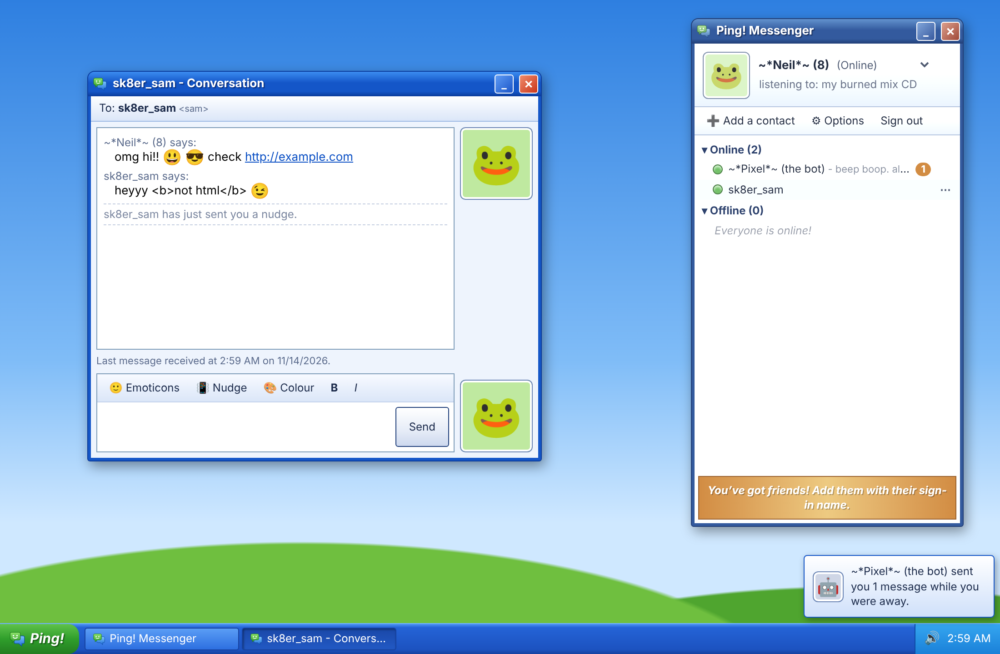

# Ping! Messenger

A nostalgic, early-2000s style instant messenger that actually works: real accounts,
real-time chat, presence, nudges, emoticons, and a tiny desktop with draggable windows
and a taskbar. All artwork, names and sounds are original.



## Run it

Requires Node.js 22.13 or newer.

```bash
npm install
npm start          # http://localhost:3000
```

Open it in two browsers (or one normal + one private window), create two accounts, and
add each other with **Add a contact**. Every new account also gets **Pixel**, an
always-online bot buddy, so there is someone to talk to straight away.

| Setting    | Default  | Meaning                               |
|------------|----------|---------------------------------------|
| `PORT`     | `3000`   | HTTP / WebSocket port                 |
| `DATA_DIR` | `./data` | Where the SQLite database file lives  |

`npm test` runs the server test suite; `npm run dev` restarts on file changes.

## Features

- **Accounts**: sign up / sign in, "remember me", choose your status when signing in
- **Contact list**: Online / Offline groups, contact requests (allow / decline), block, delete
- **Presence**: Online, Busy, Be right back, Away, On the phone, Out to lunch, Appear offline
- **Profile**: display name, personal message, display pictures
- **Conversations**: one window per contact, "is typing a message..." indicator, message
  history, offline messages delivered on next sign-in, unread badges
- **Nudges**: shake your friend's window (rate limited, as tradition demands)
- **Emoticons**: type `:)` `:D` `;)` `:P` `(H)` `(L)` `(Y)` ... or use the picker
- **Fonts**: message colour, bold and italic
- **Desktop feel**: draggable windows, taskbar with flashing buttons, sign-in toasts, and
  synthesised sounds (mute from the tray)
- Works on phones too: windows go full screen and the taskbar switches between them

## How it is built

```
server/index.js   HTTP (static files + /api/register, /api/login, /api/logout) and the WebSocket hub
server/db.js      SQLite storage via Node's built-in node:sqlite
server/bot.js     Pixel, the built-in buddy
public/           The client: plain HTML, CSS and JavaScript, no build step
test/             node:test suite covering auth, contacts, presence, messaging, blocking
```

The only dependency is [`ws`](https://github.com/websockets/ws).

Security basics are in place: passwords are hashed with scrypt, session tokens are stored
hashed, sign-in attempts and message rates are limited, WebSocket connections are checked
for same origin, and all chat text is rendered as text (never HTML). For use on the public
internet, put it behind HTTPS (any reverse proxy that forwards WebSockets will do).
