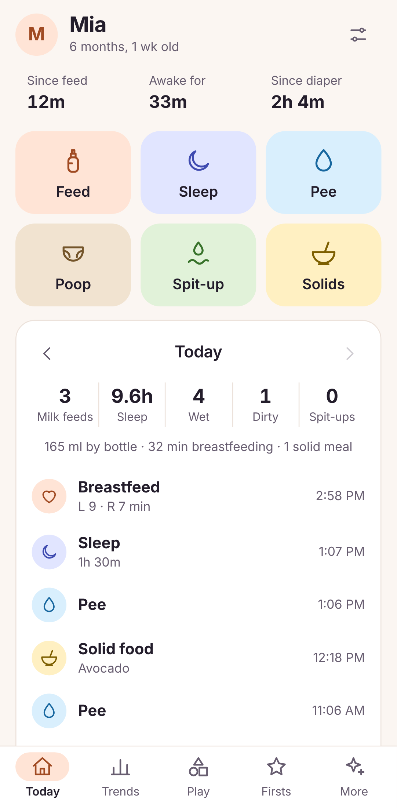
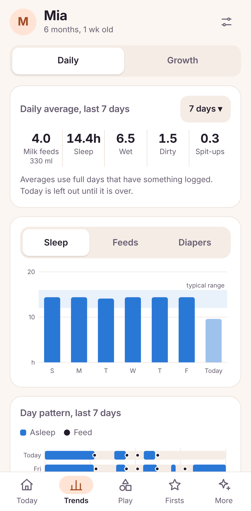
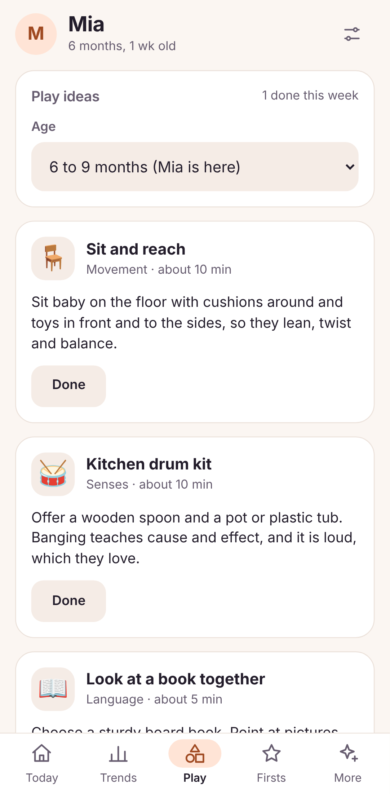

# TinyLog: baby tracker for Android

Track feeds, sleep, pees, poops, spit-ups, first words, first foods, weight and height,
keep a gear wishlist, and get suggestions, both built-in and from AI.

| Today | Trends | Play |
|---|---|---|
|  |  |  |

## What it does

| Tab | Details |
|---|---|
| **Today** | One-tap Pee, Poop and Spit-up; Feed (breastfeeding timer with left/right and pause, or enter minutes; bottle amount; solids), pre-filled from the last feed; Sleep with start/stop or past entry; time since last feed and diaper; daily totals; tap any entry to edit; delete with undo; browse previous days |
| **Trends** | Daily averages over 7, 14 or 30 days (the numbers a doctor asks for); bar charts for sleep (with the typical range for the age), milk feeds, and wet/dirty diapers; a 24-hour day-pattern strip showing when sleep and feeds happen; weight and height with a chart each |
| **Play** | Activity ideas for the baby's age (30 ideas across six age bands): what to do, what it supports, how long; mark as done to keep count |
| **Firsts** | First words with the age they were said; first foods with reaction and possible-allergy flag (logging a solid feed adds new foods automatically); starter-food ideas by age with safe preparation, allergen labels, and what to wait on |
| **More** | Built-in tips from your own logs (work offline) and **Ask the AI** when an AI service is set; Gear wishlist with category, price, shop link and priority, plus ideas by age |
| **Settings** | Metric or imperial, currency, backup to a file and restore, delete everything |

All data stays on the phone. Nothing is sent anywhere unless you ask the AI a question,
and then only a short summary of the logs is sent.

## Get the Android app

The repository builds itself on GitHub. Open the **Actions** tab, pick the latest
"Build TinyLog (Android)" run, and download **TinyLog-debug-apk**. Unzip it and open
`app-debug.apk` on an Android phone to install (you will be asked to allow installing from
that source).

To build on your own computer you need Node 22+, JDK 21 and Android Studio:

```bash
cd baby-tracker
npm install
npx cap sync android      # copies www/ into the Android project
npx cap open android      # opens Android Studio; press Run
```

`npm start` serves the app at http://localhost:5173 for trying it in a desktop browser.
`npm test` runs the logic tests.

## Turning on AI suggestions

The app never holds an API key. It talks to the small server in [`ai-server/`](ai-server),
which holds the key and calls Claude.

```bash
cd baby-tracker/ai-server
npm install
ANTHROPIC_API_KEY=sk-ant-... npm start     # listens on port 8787
```

Host it anywhere that runs Node and gives you an `https://` address, then either type that
address into the app under **Settings > AI service address**, or set `DEFAULT_AI_URL` in
[`www/js/config.js`](www/js/config.js) before building so every install has it.

The server limits each address to 6 questions a minute (`RATE_LIMIT_PER_MINUTE`). Before a
public launch, add sign-in or an app check so that only your app can use your API key.

## Publishing to the Play Store

1. Create a Google Play developer account ($25, one-off) and a new app in the Play Console.
2. Create an upload key once, and keep the file and passwords safe:
   ```bash
   keytool -genkey -v -keystore tinylog.keystore -alias tinylog -keyalg RSA -keysize 2048 -validity 10000
   ```
3. In the GitHub repository, add these under Settings > Secrets and variables > Actions:
   `TINYLOG_KEYSTORE_BASE64` (output of `base64 -w0 tinylog.keystore`),
   `TINYLOG_KEYSTORE_PASSWORD`, `TINYLOG_KEY_ALIAS` (`tinylog`), `TINYLOG_KEY_PASSWORD`.
4. Run the workflow again. It now also produces **TinyLog-release-aab**; upload that
   `.aab` file in the Play Console.
5. For each new release, raise `versionCode` and `versionName` in `android/app/build.gradle`.

Play also asks for a privacy policy link, a Data safety form (the AI feature sends log
summaries to your server), screenshots, and the 512 px icon in `store/`. The app id is
`com.tinylog.babytracker`; change it in `capacitor.config.json` and
`android/app/build.gradle` before the first upload if you want your own, because it cannot
be changed afterwards.

## A note on health information

TinyLog gives general information, not medical advice. The built-in tips and food ideas
follow mainstream guidance (solids from around 6 months, no honey before 12 months, safe
sleep on the back) and tell parents when to contact a doctor. Have the content reviewed for
the countries you publish in.

## Layout

```
www/            the app: HTML, CSS and JavaScript modules, no build step
  js/activities.js  play ideas by age
  js/icons.js     line icons
  js/logic.js     units, ages, daily summaries, built-in tips, AI summary
  js/content.js   food ideas and gear ideas
  js/chart.js     line, bar and day-pattern charts
  js/app.js       screens and forms
android/        Android project generated by Capacitor
ai-server/      backend for AI suggestions
test/           tests for logic.js
```
